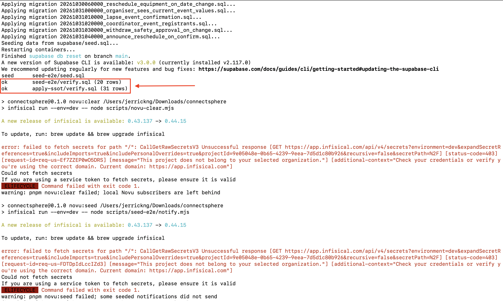

# ConnectSphere

Event management platform covering event requests, review, venue booking,
equipment reservation, attendee registration and notifications.

IS212 Software Project Management, Team T6 (Pygmies).
Repository: https://github.com/SPM-T6-Pygmies/connectsphere

## Try it now (recommended)

**Live app: https://connectsphere-one-azure.vercel.app**

Please use the deployed app to test. It is already loaded with sample data.
Only [run it locally](#run-locally-fallback-only) if it is unavailable.

All accounts use the password `TestPass123!`

| Role | Email |
|---|---|
| Event Organiser | organiser@test.com |
| Event Coordinator | coordinator@test.com |
| Event Coordinator Lead | lead@test.com |
| Venue Staff | venue@test.com |
| Technical Support Staff | support@test.com |
| Safety Officer | safety@test.com |

Each role has a second account (e.g. `organiser2@test.com`) for testing
access between users. Attendees have no login: as confirmed by the customer,
they register with a name and email at
https://connectsphere-one-azure.vercel.app/events.

## Suggested walkthrough

1. **Organiser:** create a draft event request, then submit it
2. **Coordinator Lead:** assign a coordinator
3. **Coordinator:** approve the request, then request a venue booking
4. **Venue Staff:** approve the booking
5. **Coordinator:** list the equipment needed
6. **Technical Support:** reserve the equipment
7. **Safety Officer:** approve the safety check
8. **Coordinator:** confirm the event and open registration
9. **Attendee:** register on the public events page

Check the notification bell after each step.

## Tech stack

| Layer | Technology |
|---|---|
| Frontend and server | Next.js 16, React 19, TypeScript |
| UI | Tailwind CSS 4, shadcn/ui (Radix) |
| Database and auth | Supabase (PostgreSQL, Auth) |
| Notifications | Novu |
| Testing | Vitest |
| CI | GitHub Actions |
| Hosting | Vercel |

## Project structure

Built with Ports & Adapters: business logic never depends on external systems.

```text
src/
├── app/            Pages and routes (staff views in app/staff/<role>)
├── components/     Shared UI
├── core/
│   ├── domain/     Business rules
│   ├── use-cases/  Application workflows
│   └── ports/      Interfaces to external systems
├── adapters/       Implementations of those interfaces
└── composition/    Wiring between ports and adapters
supabase/           Migrations, schema and seed data
scripts/            Test data and helper scripts
docs/               Architecture, database and test documents
visual-map/         C4 model
.github/workflows/  CI pipelines
```

## Where to find things

| Looking for | Go to |
|---|---|
| Architecture decisions | `docs/ARCHITECTURE.md` |
| C4 model | `visual-map/` (view with `pnpm visual-map`, requires Docker) |
| Automated test cases and traceability | `docs/tests/test-registry.csv` |
| Automated test run history | `docs/tests/test-runs.csv` |
| Manual test cases | `docs/tests/manual-registry.csv`, `docs/manual-test-documents/` |
| Manual test run history | `docs/tests/manual-runs.csv` |
| Manual test screenshots | `docs/screenshots/` (search by case ID, e.g. `TC-VCAT-004`) |
| Unit tests | Beside the code, as `*.test.ts` |
| CI pipeline | `.github/workflows/ci.yml` |

## Testing and CI

Run the tests with `pnpm test`.

- **Automated tests:** 3,114 passing at the last recorded run (1 Nov 2026)
- **Traceability:** test names carry their Linear ticket, which links them to
  the user story and acceptance criteria

CI runs type checks, linting, tests and a build on every pull request and every
push to `main`. Passing runs on `main` are recorded in the test run history.

## Run locally (fallback only)

Only use these steps if the deployed app is unavailable.

### Requirements

Run the check command for each one to confirm it is installed.

1. **Node 20.19+ or 22.12+.** Check with `node --version`.
2. **pnpm 9.** Check with `pnpm --version`.
3. **Docker, running.** Check with `docker info`. An error means Docker is not
   installed or not running.
4. **Supabase CLI.** Check with `supabase --version`. To install it:

   ```bash
   # macOS or Linux (requires Homebrew)
   brew install supabase/tap/supabase

   # Windows (requires Scoop)
   scoop bucket add supabase https://github.com/supabase/scoop-bucket.git
   scoop install supabase
   ```

   For other options, see the
   [Supabase CLI guide](https://supabase.com/docs/guides/local-development/cli/getting-started).

### 1. Clone the repo

```bash
git clone https://github.com/SPM-T6-Pygmies/connectsphere.git
cd connectsphere
```

Ensure that the `.env.local` file is inside the project root. It is a hidden
file, so use `ls -a` to see it. Cloning does not include it, so copy it from
folder `6. Software Release`.

### 2. Start the app

Run these from the project root:

```bash
pnpm install
supabase start
pnpm e2e:data reset
npx novu@latest dev --port 3000 --headless --run "pnpm dev"
```

`pnpm e2e:data reset` replaces any existing local data with sample data.

**Expected errors.** This command ends with Infisical or Novu errors, and their
wording may differ between machines. This is expected. Those steps need secrets
the team keeps in Infisical, and step 3 sends the sample notifications instead.

Setup worked if you see both of these lines, even with errors below them:

```text
ok        seed-e2e/verify.sql (20 rows)
ok        apply-ssot/verify.sql (31 rows)
```



Stop and investigate if any migration fails, or if either `ok` line is missing.

### 3. Turn on notifications

The last command prints a line like this:

```text
🛣️  Tunnel    → https://<your-tunnel-address>/api/novu
```

1. Copy the full URL into `NOVU_BRIDGE_URL` in `.env.local`.
2. Press Ctrl+C, then run the `npx novu@latest dev` command again.
3. Leave it running. In a second terminal, run this from the project root
   to load the sample notifications:

   ```bash
   node scripts/seed-e2e/notify.mjs
   ```

### 4. Sign in

Open http://localhost:3000 and sign in with the accounts listed
[above](#try-it-now-recommended).
